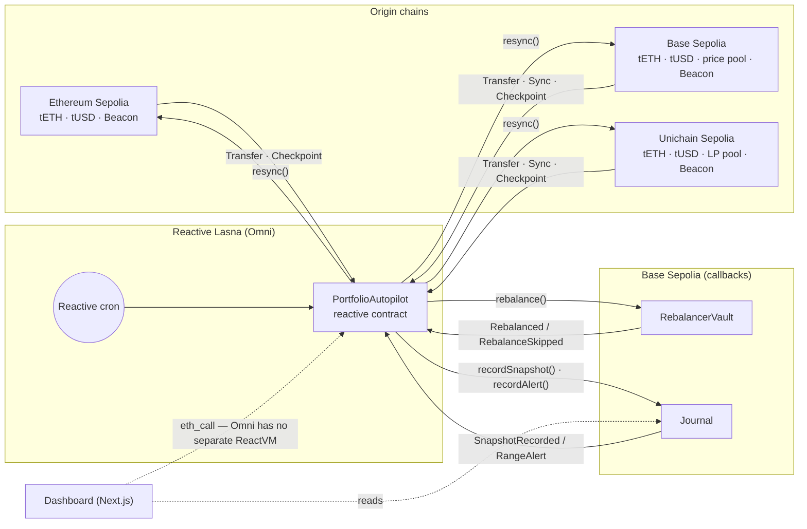
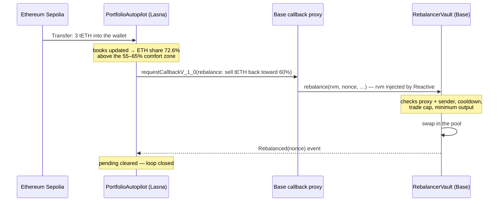

# Omni Autopilot — set it and forget it, across three chains

**A portfolio autopilot that lives entirely on-chain.** One reactive contract on Reactive Omni watches a wallet on Ethereum Sepolia, Base Sepolia and Unichain Sepolia, keeps its cross-chain books, rebalances back to your target mix, warns you when the price leaves your LP range, and writes a daily diary — with no bot, no server and no keeper.

> Built for the **Reactive Omni Buildathon** — track: **Set It and Forget It**.
> It covers three of the track's suggested ideas at once: a portfolio tracker, an alert when a liquidity position hits a price, and custom rebalancing rules.

- **Live dashboard:** https://omni-autopilot.vercel.app
- **Proof of the full loop:** [docs/EVIDENCE.md](docs/EVIDENCE.md) — origin event → reactive tx → callback, with explorer links. Measured origin-to-callback latency: **1–2 seconds**.
- **Demo video:** _link goes here_

---

## The problem, in plain English

If your money sits on several chains, nobody is watching the whole picture. A wallet app shows one chain at a time. Keeping a 60/40 mix means checking every chain, adding it up, and trading by hand — or running a bot on a server that you have to keep alive, fund and trust.

Omni Autopilot is the "set it and forget it" version: you write your rules once (target mix, comfort zone, LP range, how often to journal) and contracts do the rest.

## What it does

| | |
|---|---|
| **Tracks** | Every tETH/tUSD transfer in or out of the wallet on three chains updates an on-chain ledger, per chain. |
| **Prices** | Reads the tETH price straight from a Uniswap-V2-style pool's `Sync` events. |
| **Rebalances** | When the ETH share of the *whole* cross-chain portfolio leaves its comfort zone (default 60% ± 5%), it tells the vault on Base Sepolia to trade back to target. |
| **Alerts** | When the Unichain pool price leaves your LP range (default $1,800–$2,200), or comes back, it records an alert. |
| **Journals** | Reactive's built-in cron wakes it up to write portfolio snapshots to a Journal on Base — the history chart on the dashboard. |
| **Self-heals** | After each snapshot it asks a beacon on each chain to re-publish *real* balances, so a missed event can never leave the books wrong for long. |

## How it works



A rebalance, step by step (this exact loop is in [docs/EVIDENCE.md](docs/EVIDENCE.md)):



### Why it needs Reactive (and Omni in particular)

- **The reactive contract does the real work.** It holds the subscriptions, the cross-chain ledger, the decision logic and the schedule. Nothing off-chain decides anything.
- **Cross-chain by design.** A transfer on Unichain or Sepolia causes a trade on Base. No chain could do that on its own, and no bridge message is needed.
- **Omni makes it simple to show.** With no separate ReactVM, the autopilot's state is ordinary contract state on Lasna, so the dashboard reads live holdings with a plain `eth_call`. With ~1 s blocks and instant finality, the origin-to-callback loop measured **1–2 s**.

## Contracts

| Contract | Chain | Address |
|---|---|---|
| `PortfolioAutopilot` (reactive) | Reactive Lasna | [`0x45750C2d44889faAeCFf4A1DD0986AACb972eAD7`](https://lasna.reactscan.net/address/0x45750C2d44889faAeCFf4A1DD0986AACb972eAD7) |
| `RebalancerVault` | Base Sepolia | [`0xe964Fd709E373fd7fe0D05D052eFf58F747AC94e`](https://sepolia.basescan.org/address/0xe964Fd709E373fd7fe0D05D052eFf58F747AC94e) |
| `Journal` | Base Sepolia | [`0xa12413eDA3f079037B1212c4253Bc86cDbd7e3C8`](https://sepolia.basescan.org/address/0xa12413eDA3f079037B1212c4253Bc86cDbd7e3C8) |
| `BalanceBeacon` | Base Sepolia | [`0x4D39830176090Df0a2dc433B91bd4263f2c7A8c4`](https://sepolia.basescan.org/address/0x4D39830176090Df0a2dc433B91bd4263f2c7A8c4) |
| `BalanceBeacon` | Unichain Sepolia | [`0xe964Fd709E373fd7fe0D05D052eFf58F747AC94e`](https://sepolia.uniscan.xyz/address/0xe964Fd709E373fd7fe0D05D052eFf58F747AC94e) |
| `BalanceBeacon` | Ethereum Sepolia | [`0x939856f34105639013B0a541885cD82c66Ab2Ed5`](https://sepolia.etherscan.io/address/0x939856f34105639013B0a541885cD82c66Ab2Ed5) |
| `DemoPool` tETH/tUSD (price) | Base Sepolia | [`0x55261feE0c85b940EA250A8b6C0d69D88AB9C1E0`](https://sepolia.basescan.org/address/0x55261feE0c85b940EA250A8b6C0d69D88AB9C1E0) |
| `DemoPool` tETH/tUSD (LP alert) | Unichain Sepolia | [`0x55261feE0c85b940EA250A8b6C0d69D88AB9C1E0`](https://sepolia.uniscan.xyz/address/0x55261feE0c85b940EA250A8b6C0d69D88AB9C1E0) |
| tETH / tUSD | Base & Unichain Sepolia | `0x2eE80f8764E2c389DAf9Bc8FD84B70D1EB003506` / `0xddA7C91fE406D02DB364BC580795d77B5fEf1Aaa` |
| tETH / tUSD | Ethereum Sepolia | `0x8784a7448ca8B3469B9934ba148abb4cBcFdAF48` / `0x3c5D5510A91dDbffB389acC25c6128B17993413D` |

Watched (demo) wallet: `0x6493130815a21efc15747384233a0ad767702eB8`. Some addresses repeat across chains because the same deployer nonce was used on each; the autopilot keys everything by chain id.

### What each contract does

- **`PortfolioAutopilot`** ([src](contracts/src/PortfolioAutopilot.sol)): subscriptions, the cross-chain ledger (`balanceOf[chain][token][holder]`), pricing, the band check, LP range state, cron scheduling and callbacks. `react()` never reverts on unexpected input, de-duplicates a log that matches two subscriptions (for example wallet → vault), and spreads heavy cron work over several ticks so each reactive transaction stays well under the 900k gas cap.
- **`RebalancerVault`** ([src](contracts/src/RebalancerVault.sol)): the managed slice of the portfolio on Base. Its safety rails live on Base, so they hold even if the reactive side misbehaves: only the callback proxy carrying this autopilot's address can call it, a **timestamp** cooldown (Base makes 200 ms blocks), a per-trade cap, and a minimum-output check. It never reverts on a rule check; it emits `RebalanceSkipped`, so the autopilot always hears back.
- **`Journal`** ([src](contracts/src/Journal.sol)): stores snapshots and alerts written by callbacks.
- **`BalanceBeacon`** ([src](contracts/src/BalanceBeacon.sol)): reads real `balanceOf` and emits `Checkpoint`. Anyone can trigger it (it can only report the truth); the autopilot triggers it by callback after each snapshot.
- **`DemoPool` / `DemoToken`**: a minimal x·y=k pool that emits the exact Uniswap V2 `Sync`/`Swap` events, plus labelled test tokens. Pointing the autopilot at a real V2 pair needs no code change.

## Your rules (all on-chain, owner-settable)

| Rule | Default | Setter |
|---|---|---|
| Target ETH share | 60% | `setRules` |
| Comfort zone | ± 5% | `setRules` |
| Max slippage | 2% | `setRules` |
| Cooldown between trades | 120 s | `setRules` |
| LP range | $1,800 – $2,200 | `setRange` |
| Snapshot interval | 4 h | `setSnapshotSchedule` |
| Wake-up frequency | every 1,000 Lasna blocks (~17 min) | `setCronInterval(100 \| 1000 \| 10000)` |
| Pause | off | `setPaused` (keeps tracking, stops acting) |

## Tests

```bash
cd contracts && forge test
```

31 Foundry tests, including a 256-run fuzz test that the on-chain books always equal real balances. `test/utils/OmniHarness.sol` simulates Reactive inside one EVM: a mock system contract records subscriptions, routes each origin log to `react()` once per matching subscription (like the real network), and delivers callbacks through a per-chain proxy with the reactive address injected and gas held back. It asserts every `react()` stays under the 900k cap and every callback asks for at least 100k gas. The tests caught three real bugs before the first deployment: a missing start-up price, a cron tick that could exceed the gas cap, and a demo assumption about vault draining.

## Run it yourself

Prerequisites: [Foundry](https://getfoundry.sh), Node 20+.

```bash
git clone --recurse-submodules <this repo> && cd <repo>
cp contracts/.env.example contracts/.env
node scripts/new-wallet.mjs           # creates a testnet key in contracts/.env and prints only the address
```

Fund that address with Sepolia ETH (send some to Reactive's faucet `0x9b9BB25f1A81078C544C829c5EB7822d747Cf434` for lREACT, 100 lREACT per ETH), plus a little Base Sepolia and Unichain Sepolia ETH. Then:

```bash
cd contracts && set -a && . ./.env && set +a
forge script script/Deploy.s.sol:DeployAssets   --rpc-url $SEPOLIA_RPC          --broadcast   # repeat for $BASE_SEPOLIA_RPC and $UNICHAIN_SEPOLIA_RPC
forge script script/Deploy.s.sol:DeployAutopilot --rpc-url lasna --broadcast --with-gas-price 101gwei --priority-gas-price 1gwei
forge script script/Deploy.s.sol:DeployCallbacks --rpc-url $BASE_SEPOLIA_RPC     --broadcast   # repeat for the other two chains
forge script script/Deploy.s.sol:Configure       --rpc-url lasna --broadcast --with-gas-price 101gwei --priority-gas-price 1gwei
forge script script/Deploy.s.sol:SeedBook        --rpc-url $BASE_SEPOLIA_RPC     --broadcast   # repeat for the other two chains
```

(On Lasna, cap the gas price: the node refuses any transaction whose maximum fee could exceed 1 lREACT.)

Try it:

```bash
bash scripts/demo.sh status          # what the autopilot sees
bash scripts/demo.sh gift-eth 3      # tETH lands on Sepolia → vault sells on Base
bash scripts/demo.sh gift-usd 6000   # tUSD lands on Unichain → vault buys on Base
bash scripts/demo.sh price-drop      # Unichain price leaves the LP range → alert
bash scripts/demo.sh price-recover   # price comes back → alert
node scripts/evidence.mjs            # markdown table of every full loop
```

Dashboard:

```bash
cd dashboard && npm install && npm run sync-deployments && npm run dev
```

## Costs and keeping it alive

Every reactive transaction is billed in lREACT. At Lasna's 100 gwei base fee, a reaction costs about 0.02–0.05 lREACT. Waking every ~17 min costs roughly 1.5–2 lREACT a day; switching to every ~3 h (`setCronInterval(10000)`) costs about 0.2 a day, while transfers and price moves still get an instant reaction. The callback contracts pay for their own callbacks in testnet ETH (`coverDebt()` / the proxy's `depositTo`).

## Honest notes

- Everything runs on testnets. tETH and tUSD are test tokens with no value, and the watched wallet is a demo wallet. All activity you see was generated by us to demonstrate the system.
- Price moves in the demo come from a separate "market" wallet that sells test tokens into the pool; the watched wallet is not involved, so only the price changes.
- This is deployment v2. We retired v1 (addresses in `contracts/deployments/v1/`) after spotting that a rebalance retry could wait behind the post-snapshot beacon re-syncs; v2 retries on every tick (see `test_retryNotDelayedByResyncTicks`). v1's loops are still on-chain.

## Repository layout

```
contracts/   Foundry project: src/, test/, script/, deployments/ (addresses), broadcast/ (deploy receipts)
dashboard/   Next.js 16 + viem + Tailwind 4 + Framer Motion dashboard
scripts/     new-wallet.mjs (key → .env, prints address only), demo.sh, evidence.mjs, check-secrets.sh
docs/        EVIDENCE.md, PLAN.md, video script and submission text
```

## License

MIT for this project's code. The Reactive library (`lib/reactive-lib-omni`) and forge-std are dependencies under their own terms.
